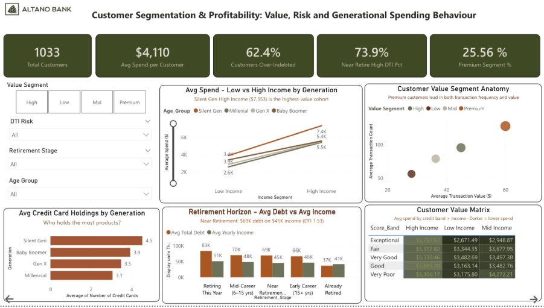
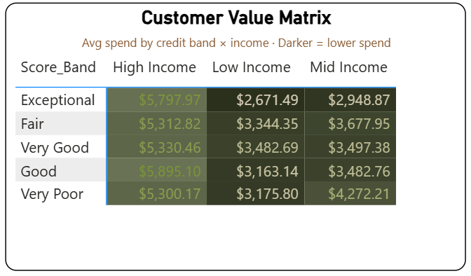
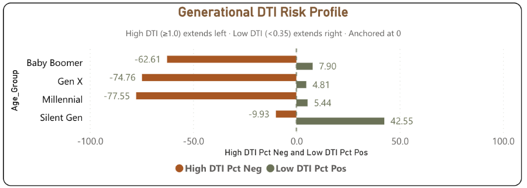
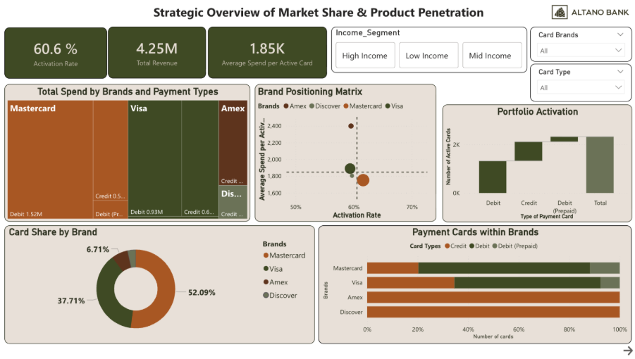
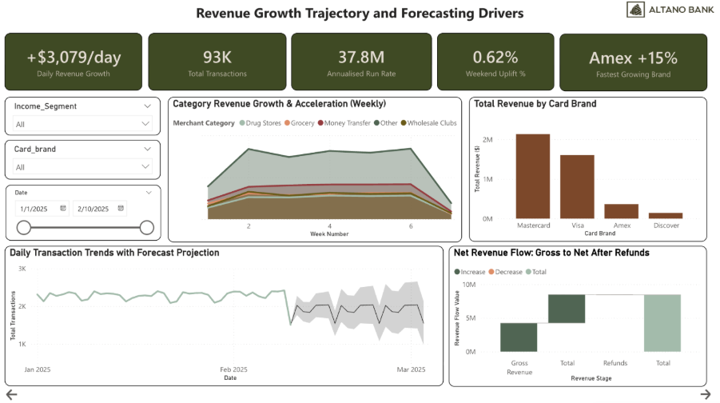
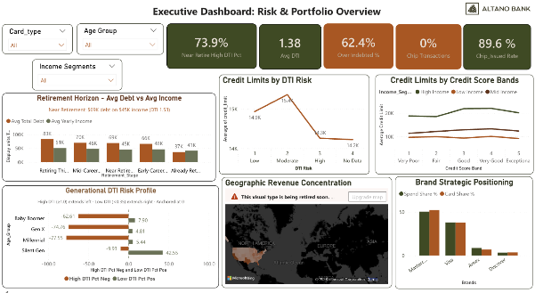
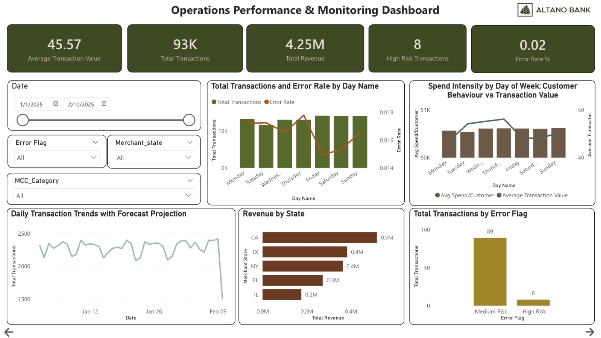
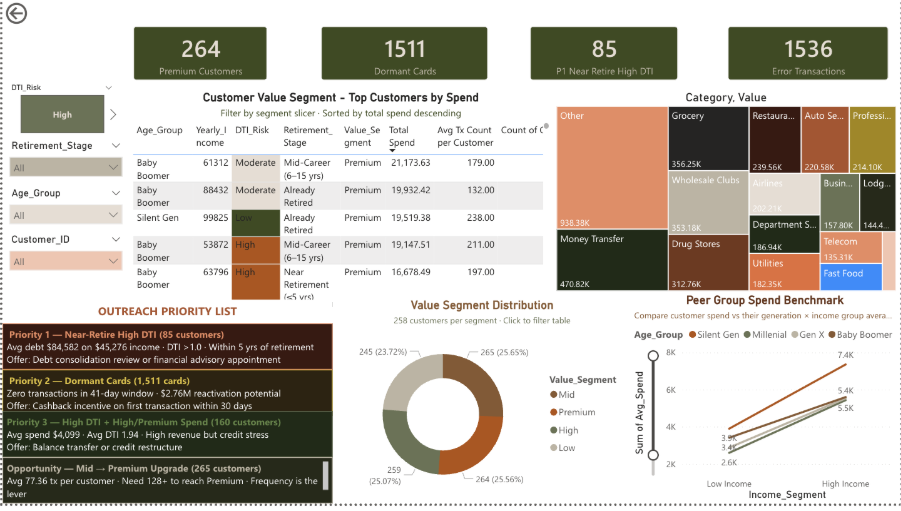
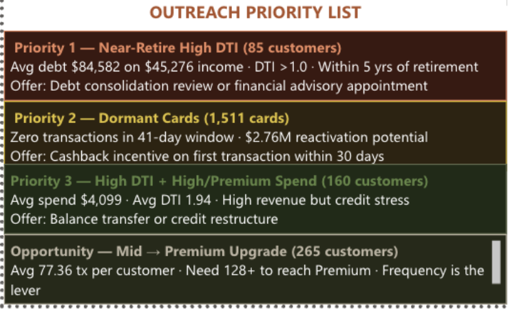

# Altano Bank: Business Intelligence & Analytics

**A six-page Power BI solution that turns messy multi-source banking data into decision-ready intelligence for the board, operations and frontline staff.**

[Overview](#overview) • [Key findings](#key-findings) • [Dashboards](#dashboards) • [Data model & cleansing](#data-model--cleansing) • [Recommendations](#recommendations)

## Overview

Altano Bank is preparing to enter the Australian market. Its Executive Board needed clear, evidence-based answers about portfolio performance, customer risk and whether its growth will last. The raw data, spread across three sources, was inconsistent.

This project rebuilds that data into a single clean model. It then serves the model through dashboards designed for three audiences, because each one acts on a different part of the same picture:

| Audience | Question they need answered |
| --- | --- |
| **Executive Board** | Where are our portfolio risk and revenue concentrated, and how sustainable is our growth? |
| **Operations Managers** | Where are errors and performance problems happening right now? |
| **Customer Service Officers** | Who is this customer, what is their financial situation, and what should I do next? |

The analysis follows the Data → Information → Knowledge → Wisdom (DIKW) hierarchy (Ackoff, 1989). Section A covers enterprise-level analysis. Section B turns those insights into role-specific dashboards.

> [!NOTE]
> This is an academic project for Deakin University (Trimester 1, 2026). Altano Bank is a fictional organisation. The figures below come from the dataset supplied for the assignment.

### My role

I was the BI analyst. I cleaned and joined the three raw datasets and built the DAX analytical layer. I also designed the audience-specific dashboards that turn enterprise findings into decisions each role can act on.

## Key findings

- **Income, not credit score, drives spend.** Yearly income correlates moderately with total spend (r = 0.41). Credit score shows no correlation (r = –0.02). Low-income customers with *Exceptional* credit spend less ($2,671) than *Very Poor* credit customers in the same income band ($3,176).
- **Debt risk is generational and predictable.** 62.4% of customers are over-indebted (DTI ≥ 1.0). The risk is concentrated in Gen X (74.76% high-DTI) and Millennials (77.55%). Customers near retirement carry $71,258 average debt against $47,760 income.
- **$2.76M is sitting in dormant cards.** 39.4% of issued cards (1,511 of 3,832) recorded no transactions during the observation period. They are a low-cost reactivation opportunity that needs no new acquisition spend.
- **A gap between security policy and practice.** 89.6% of cards are chip-enabled, yet 100% of transactions ran on magnetic-stripe swipe.
- **Growth is volatile, not structural.** High-Income customers drive the strongest daily revenue growth (+$2,871/day). Mid-Income customers generate high volume but negative growth (–$388/day), which points to revenue leakage.
- **Brand mix matters more than share.** Mastercard leads on share (52.09%) but has the lowest revenue per card ($1,750). Amex has a credit-only portfolio and earns $2,400 per card. Discover underperforms on every metric.

<table>
  <tr>
    <td width="50%"></td>
    <td width="50%"></td>
  </tr>
  <tr>
    <td align="center">Customer Value Matrix: income outweighs credit band</td>
    <td align="center">Generational DTI Risk Profile</td>
  </tr>
</table>

## Dashboards

The report has six pages: three enterprise-level analysis pages and three dashboards built for specific audiences.

### Section A: Strategic analysis

| Page | Focus |
| --- | --- |
| **A1. Market Share & Product Penetration** | Brand and card-type composition, activation rates, revenue per card, brand positioning matrix |
| **A2. Customer Segmentation & Profitability** | Customer value matrix, income vs. credit-score correlation, generational DTI risk, retirement horizon, drill-through to individual customers |
| **A3. Revenue Growth & Forecasting** | Daily growth by income segment, weekly category acceleration, transaction trend with forecast projection |

<b>View Section A screenshots</b>

#### A1. Market Share & Product Penetration

#### A2. Customer Segmentation & Profitability

#### A3. Revenue Growth & Forecasting

### Section B: Audience dashboards

| Dashboard | Audience | What it enables |
| --- | --- | --- |
| **B1. Executive: Risk & Portfolio Overview** | C-suite, board directors | KPI cards for chip usage, chip issuance and average DTI (1.38); U.S. revenue concentration map; credit limits by DTI and score band |
| **B2. Operations Performance & Monitoring** | Operations managers | Transaction volume and error rates over time, errors by state, brand and merchant category, day-of-week demand patterns |
| **B3. Business Users** | Customer service officers, relationship managers | Customer table with conditional risk formatting, spend treemap, peer-group benchmark, and an **Outreach Priority List** |

<b>View Section B screenshots</b>

#### B1. Executive Dashboard

#### B2. Operations Performance & Monitoring

#### B3. Business Users

The Outreach Priority List turns abstract risk segments into a call list. For example, it flags 85 near-retirement customers with high DTI for debt-consolidation or advisory outreach instead of more credit.

## Data model & cleansing

| Dataset | Records (post-cleansing) | Notes |
| --- | --- | --- |
| Transactions | 93,181 | 1 Jan – 10 Feb 2025; $4.25M total value; 461 refunds retained; 1,536 error transactions flagged |
| Customers | 1,033 | Every customer has at least one transaction, with no orphaned records |
| Cards | 3,832 | 2,321 active (60.6%), 1,511 dormant (39.4%) |

The cleansing process follows the **Intelliclean** framework (Lee et al., 2004). Data quality was assessed against the **ISO/IEC 25012** data quality model.

1. **Structural cleaning (Excel):** fixed typos in column names (`Trasnaction_ID` → `Transaction_ID`), standardised naming to Title_Case, and normalised every date field to DD/MM/YYYY.
2. **Integrity fixes:** stored `Merchant_Postcode` as text so leading zeros are kept, and flagged 20 future-dated `acct_open_date` records and excluded them from cohort analysis.
3. **Analytical enrichment (Power Query and DAX):** added the derived columns `Error_Risk_Level`, `DTI_Risk`, `Value_Segment` and `Income_Segment`, which power OLAP slice-and-dice across brand, card type, income segment and generation (Kimball & Ross, 2013).

> [!IMPORTANT]
> The final day (10 Feb 2025) is a partial extract: 1,508 transactions against a daily average of 2,273. It is kept in the model but excluded from trend baselines and forecasts.

## Recommendations

1. **Move from credit-score-led to income-led, DTI-gated decisions.** Income and engagement should trigger growth actions such as limit increases, targeting and upgrades. DTI thresholds should then gate those actions and send high-risk customers to stabilisation pathways.
2. **Target operational controls where errors cluster.** Apply validation, automation and real-time monitoring to the specific states, brands and categories with the most errors, not uniformly across the bank.
3. **Mandate chip transactions** and set a timeline for decommissioning swipe, closing the gap between card capability and fraud exposure.
4. **Diversify geographically.** California, Texas and New York hold about 30% of revenue. Grow mid-tier states such as Florida, Illinois and Georgia, where the bank is present but under-indexed.

## What's next

- Extend the $2.76M dormant-card opportunity into a **propensity-to-reactivate model** that produces a prioritised outreach list.
- Add a **live DTI monitoring page** so Altano can track portfolio DTI drift each quarter instead of relying on a point-in-time snapshot.

## Tools & methods

**Tools:** Power BI · Power Query · DAX · Excel

**Methods:** Data cleansing (Intelliclean, ISO/IEC 25012) · OLAP / dimensional modelling · Correlation & segmentation analysis · Trend forecasting · Persona-mapped dashboard design and visual hierarchy
